```{r}
#| label: setup
#| include: false

# El informe se renderiza desde informe/; las rutas del analisis son relativas a la raiz.
knitr::opts_knit$set(root.dir = normalizePath(".."))
```

```{r}
#| label: cargar-resultados
#| include: false

# Si no se ha corrido el analisis, o si el codigo cambio despues de la ultima corrida,
# se corre aqui. Si los resultados estan al dia, solo se leen.
fuentes <- c(list.files("R", pattern = "\\.R$", full.names = TRUE), "analisis/correr-todo.R")
if (!file.exists("figs/resultados.rds") ||
    file.mtime("figs/resultados.rds") < max(file.mtime(fuentes))) {
  source("analisis/correr-todo.R")
}
res <- readRDS("figs/resultados.rds")

# Funciones propias de R/ (el informe las usa, por ejemplo, prueba_a_tabla())
for (archivo in sort(list.files("R", pattern = "\\.R$", full.names = TRUE))) {
  source(archivo, encoding = "UTF-8")
}
faltan <- setdiff(c("res3a", "res3b"), names(res))
if (length(faltan) > 0) {
  stop("figs/resultados.rds no tiene: ", paste(faltan, collapse = ", "),
       ". El analisis se corrio con una version vieja de analisis/correr-todo.R. ",
       "Reemplacelo por la version actual y corra source('analisis/correr-todo.R') antes de renderizar.")
}

library(dplyr)
library(knitr)
```

# Estructura del repositorio

El repositorio `st-2026-2-trabajo1-ST6Q98` sigue la estructura exigida: `R/` con las funciones (`00-lectura.R` a `05-evaluacion.R`), `analisis/correr-todo.R` que ejecuta todo el análisis, `datos/` con los tres csv tal como se entregaron, `informe/` con este documento y `figs/` con las figuras que genera el análisis. El detalle de cada archivo y de su autoría está en el `README.md`.

# Las tres series y la pregunta de pronóstico

## Ficha de cada serie

La ficha se calcula con `leer_serie()` y `ficha_serie()`, y `correr-todo.R` la verifica de dos maneras: contra los valores que declara el enunciado (T y fechas) y contra una lectura independiente del csv con `read.csv`, que debe dar el mismo T, mínimo, máximo y media.

```{r}
#| label: tbl-fichas
#| tbl-cap: "Ficha de las tres series del equipo ST6Q98."

res$fichas |>
  transmute(
    Serie = serie,
    Unidad = unidad,
    Frecuencia = frecuencia,
    Inicio = format(fecha_inicial),
    Fin = format(fecha_final),
    T = T,
    Mínimo = minimo,
    Máximo = maximo,
    Media = media
  ) |>
  knitr::kable(digits = 2, format.args = list(decimal.mark = ","))
```

Las series son: (1) tiempo medio diario de espera en la estación Los Almendros; (2) pasajeros trimestrales de un aeropuerto regional; (3) viajes mensuales en una plataforma de movilidad.

## Pregunta de pronóstico, decisión y horizonte

::: {.panel-tabset}

### Serie 1: espera en estación

**Pregunta.** ¿En cuántos de los siete días de la semana siguiente (lunes a domingo) se espera que el tiempo medio de espera supere los 330 segundos?

**Decisión.** Cada viernes el operador decide cuántos buses de refuerzo despacha la semana siguiente. Cada bus cuesta 1,1 millones de pesos por día y cada día sobre la meta cuesta 12 millones de multa.

**Horizonte.** La serie termina el viernes 3 de octubre de 2025 y la decisión cubre de lunes a domingo, es decir, los horizontes h = 3, …, 9 contados desde el viernes. Por eso **H = 9**.

### Serie 2: pasajeros del aeropuerto

**Pregunta.** ¿Cuántos miles de pasajeros se esperan en cada trimestre del próximo año?

**Decisión.** El concesionario presenta cada año el plan de personal de seguridad y de apertura de salas de abordaje. Cada sala abierta sin pasajeros cuesta 90 millones de pesos por trimestre, y la congestión en los filtros genera sanciones y pérdida de rutas.

**Horizonte.** La serie termina en el cuarto trimestre de 2025 y el plan cubre los cuatro trimestres de 2026. Por eso **H = 4**.

### Serie 3: viajes de la plataforma

**Pregunta.** ¿Cuántos miles de viajes habrá que atender en cada uno de los próximos seis meses?

**Decisión.** La gerencia contrata capacidad de servidores por semestre y vincula conductores con un proceso de tres meses. Cada viaje que no se atiende por falta de conductores se pierde y deteriora la calificación de la plataforma.

**Horizonte.** La serie termina en diciembre de 2025 y la decisión cubre de enero a junio de 2026. Por eso **H = 6**.

:::

## Partición de las series

Para cada serie, con $T$ observaciones, $n_0=\lfloor 0{,}8\,T\rfloor$. Las constantes y ventanas se eligen solo en el tramo de estimación $1,\dots,n_0$; la evaluación es de origen móvil con esos parámetros fijos. Para $h=1$ los orígenes son $o=n_0,\dots,T-1$ y para el horizonte $H$ son $o=n_0,\dots,T-H$.

```{r}
#| label: tbl-particion
#| tbl-cap: "Partición en tramo de estimación y tramo de evaluación, igual para todos los métodos de una serie."

res$particiones |>
  transmute(
    Serie = serie,
    T = T,
    n0 = n0,
    H = H,
    `Orígenes h = 1` = origenes_h1,
    `Orígenes h = H` = origenes_H,
    `Estimación` = paste(format(estimacion_desde), "a", format(estimacion_hasta)),
    `Evaluación` = paste(format(evaluacion_desde), "a", format(evaluacion_hasta))
  ) |>
  knitr::kable()
```

# Descripción y patrón

## Gráfico en el tiempo y gráficos de rezagos

```{r}
#| label: ayudas-3a
#| include: false

# Ayudas para escribir cifras en el texto, por ejemplo: `r r_("serie1", 1)` o `r banda("serie1")`
fmt <- function(x, d = 2) format(round(x, d), nsmall = d, decimal.mark = ",")
r_  <- function(id, k) fmt(res$res3a[[id]]$acf[k])
banda <- function(id) fmt(1.96 / sqrt(nrow(res$datos_series[[id]])), 3)
```

::: {.panel-tabset}

### Serie 1: espera en estación

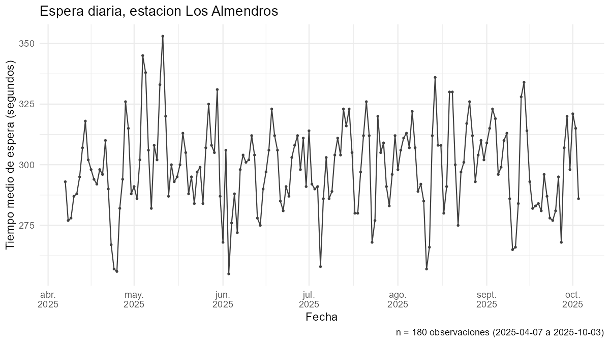{fig-alt="Serie diaria de tiempo medio de espera, en segundos"}

**Lectura del gráfico.** La serie oscila alrededor de un nivel de $\bar{y} = `r fmt(res$apoyo_s1$resumen["media"], 1)`$ segundos, con desviación estándar $s = `r fmt(res$apoyo_s1$resumen["sd"], 1)`$ s, y no muestra tendencia: no sube ni baja de forma sostenida durante los $n=180$ días. La variabilidad parece estable en todo el periodo, con un mínimo de `r fmt(res$apoyo_s1$resumen["min"], 1)` s y un máximo de `r fmt(res$apoyo_s1$resumen["max"], 1)` s, este último el `r format(res$apoyo_s1$fecha_max)`. No se ve un patrón que se repita con regularidad; sí aparecen descensos marcados cerca del cambio de mes (por ejemplo, hacia el 1 de mayo y el 1 de junio).

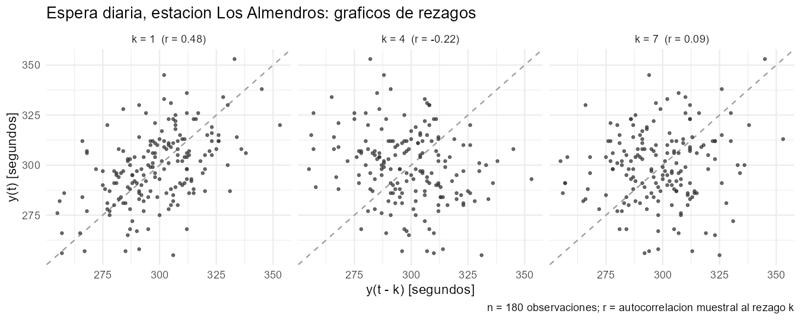{fig-alt="Gráficos de y(t) contra y(t-k)"}

**Rezagos elegidos y por qué.** Se eligieron $k=1$, $k=4$ y $k=7$, comparando $y_t$ con $y_{t-k}$ frente a la banda de ruido blanco $\pm 1{,}96/\sqrt{n} = \pm 0{,}146$ ($n=180$).

- **$k=1$ (día anterior).** Es el de mayor autocorrelación: $r_1 = 0{,}48$, fuera de la banda. La nube se alarga sobre la diagonal, es decir, hay dependencia positiva de corto plazo.
- **$k=4$ (el más negativo).** $r_4 = -0{,}22$, fuera de la banda por poco. La nube es casi redonda con leve inclinación descendente: la relación es débil.
- **$k=7$ (una semana).** Es el período natural de una serie diaria, pero $r_7 = 0{,}09$ cae dentro de la banda y la nube no tiene forma: no hay evidencia de dependencia semanal.

### Serie 2: pasajeros del aeropuerto

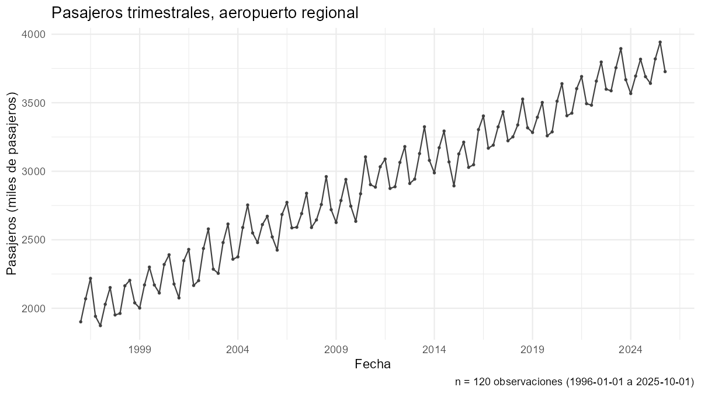{fig-alt="Serie trimestral de pasajeros, en miles"}

**Lectura del gráfico.** La serie tiene una tendencia creciente: la media anual pasa de `r fmt(res$apoyo_s2$media_anual_ini, 0)` miles de pasajeros en 1996 a `r fmt(res$apoyo_s2$media_anual_fin, 0)` en 2025, un aumento medio de `r fmt(res$apoyo_s2$crec_anual_medio, 0)` miles por año. Además se observa un zigzag que se repite cada año, con un trimestre alto y otro bajo, lo que sugiere estacionalidad de período $s=4$ (se decidirá en 3(b)).


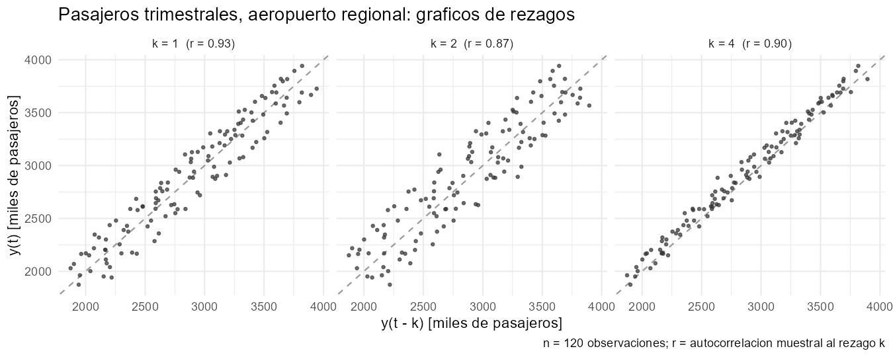{fig-alt="Gráficos de y(t) contra y(t-k)"}

**Rezagos elegidos y por qué.** Se eligieron $k=1$, $k=2$ y $k=4$, frente a la banda $\pm 1{,}96/\sqrt{n}=\pm 0{,}179$ ($n=120$).

- **$k=1$ (trimestre anterior).** $r_1=0{,}93$, fuera de la banda; la nube sigue la diagonal con dispersión moderada.
- **$k=2$ (fase opuesta del ciclo anual).** $r_2=0{,}87$, el más bajo de los tres; la nube es la más abierta.
- **$k=4$ (mismo trimestre del año anterior).** $r_4=0{,}90$, mayor que $r_2$ pese a estar más lejos; la nube es la más angosta y pegada a la diagonal.

Las tres autocorrelaciones son altas porque la serie tiene tendencia. Que $r_4 > r_2$ es una señal de estacionalidad anual.


### Serie 3: viajes de la plataforma

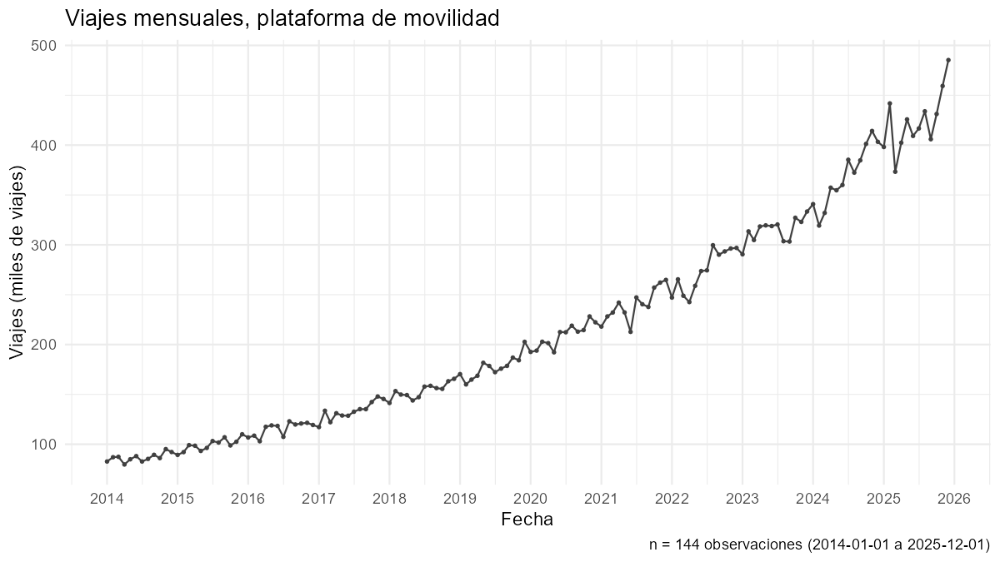{fig-alt="Serie mensual de viajes, en miles"}

**Lectura del gráfico.** La serie tiene una tendencia creciente: pasa de cerca de 90 mil viajes en 2014 a cerca de 490 mil en diciembre de 2025. La tendencia es curva, es decir, no es una recta: el crecimiento se acelera con el tiempo. La variabilidad mes a mes no es constante: al inicio los cambios son pequeños y al final son mucho más grandes, lo que indica que la variabilidad crece con el nivel de la serie. No se aprecia estacionalidad claramente en el gráfico.


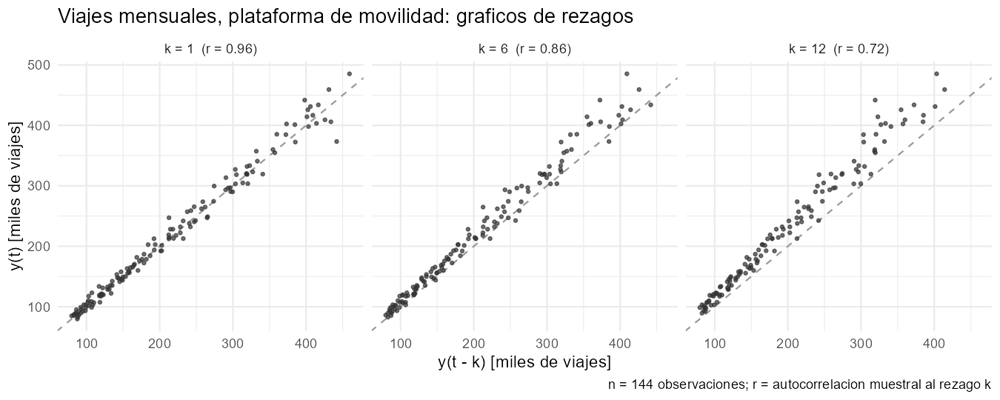{fig-alt="Gráficos de y(t) contra y(t-k)"}

**Rezagos elegidos y por qué.** Se escogieron los rezagos 1, 6 y 12 (mes anterior, medio año y un año), frente a la banda $\pm 1{,}96/\sqrt{n}=\pm 0{,}163$ ($n=144$). Las autocorrelaciones son positivas y altas ($r_1=0{,}96$, $r_6=0{,}86$, $r_{12}=0{,}72$), y las nubes siguen la diagonal. En $k=12$ la nube queda por encima de la diagonal, porque los valores actuales son mayores que los de hace un año. Las autocorrelaciones disminuyen lentamente a medida que crece $k$, lo que confirma la presencia de tendencia.

:::

```{r}
#| label: tbl-rezagos-elegidos
#| tbl-cap: "Autocorrelación muestral en los rezagos elegidos y banda de ruido blanco."

dplyr::bind_rows(purrr::imap(res$res3a, function(z, id) {
  data.frame(Serie = id, Rezago = z$rezagos, r = z$acf[z$rezagos],
             Banda = 1.96 / sqrt(nrow(res$datos_series[[id]])))
})) |>
  knitr::kable(digits = 3, format.args = list(decimal.mark = ","),
               col.names = c("Serie", "Rezago k", "r(k)", "Banda ±1,96/√n"))
```

## Estacionalidad y descomposición clásica

```{r}
#| label: ayudas-3b
#| include: false

fig_md <- function(archivo, pie) cat("\n\n", sep = "")

bloque_3b <- function(id) {
  z <- res$res3b[[id]]
  fig_md(paste0(id, "-estacional.png"), "Gráfico estacional: un trazo por ciclo sobre el índice de estación.")
  fig_md(paste0(id, "-amplitud.png"), "Amplitud de cada ciclo contra su nivel.")
  if (z$decision$estacional) {
    fig_md(paste0(id, "-descomposicion.png"), "Descomposición clásica: serie, tendencia, componente estacional y residuo.")
    fig_md(paste0(id, "-indices.png"), "Índices estacionales normalizados.")
  } else {
    fig_md(paste0(id, "-estacional-sin-tendencia.png"), "Gráfico estacional de la serie sin tendencia.")
  }
  cat("**Prueba F de estacionalidad (sobre la serie sin tendencia).**\n\n")
  cat(knitr::kable(prueba_a_tabla(z$pe$prueba), format = "pipe"), sep = "\n")
  cat("\n\n")
}
```

```{r}
#| label: tbl-resumen-3b
#| tbl-cap: "Evidencia de estacionalidad de cada serie."

res$resumen3b |>
  transmute(Serie = serie, s = s, Versión = version, F = F, `g.l.` = paste0(gl1, ", ", gl2),
            `Valor p` = p, `R² estacional` = R2_estacional,
            `Rango índices (%)` = rango_indices_pct, `r(s)` = r_s, Banda = banda_rb,
            `r(amplitud, nivel)` = cor_amplitud_nivel) |>
  knitr::kable(digits = 3, format.args = list(decimal.mark = ","))
```

::: {.panel-tabset}

### Serie 1: espera en estación

```{r}
#| output: asis
bloque_3b("serie1")
```

```{r}
#| include: false
s1 <- res$resumen3b |> dplyr::filter(serie == "serie1")
```

**Decisión sobre la estacionalidad.** La serie 1 no presenta estacionalidad semanal relevante ($s=7$): en el gráfico estacional las semanas no siguen una forma común, y aunque la prueba F rechaza $H_0$ ($F=`r fmt(s1$F, 2)`$, $p=`r fmt(s1$p, 3)`$), es decir, al menos una media por día de la semana es distinta, el efecto es pequeño: los días explican solo el `r fmt(100 * s1$R2_estacional, 1)` % de la variación ($R^2=`r fmt(s1$R2_estacional, 3)`$), el rango de los índices es el `r fmt(s1$rango_indices_pct, 1)` % del nivel medio y $r_7=`r fmt(s1$r_s, 2)`$ queda dentro de la banda de ruido blanco $\pm `r fmt(s1$banda_rb, 3)`$. Que una diferencia sea estadísticamente significativa no implica que sea importante, por eso no se atribuye estacionalidad semanal.

### Serie 2: pasajeros del aeropuerto

```{r}
#| output: asis
bloque_3b("serie2")
```

```{r}
#| include: false
s2   <- res$resumen3b |> dplyr::filter(serie == "serie2")
z2   <- res$res3b$serie2
ind2 <- z2$desc$indices
cr2  <- z2$crit$resumen
```

**Decisión sobre la estacionalidad y su período.** La serie 2 presenta estacionalidad de período $s=4$: en el gráfico estacional las líneas de cada año siguen una forma común, y la prueba F rechaza $H_0$ ($F=`r fmt(s2$F, 1)`$, $p<0{,}001$), es decir, las medias por trimestre difieren de forma significativa. El efecto es grande: los trimestres explican el `r fmt(100 * s2$R2_estacional, 1)` % de la variación ($R^2=`r fmt(s2$R2_estacional, 3)`$), con el máximo en el `r z2$etiquetas[which.max(ind2)]` y el mínimo en el `r z2$etiquetas[which.min(ind2)]`. Se elige la versión aditiva porque el nivel sube de `r fmt(cr2["nivel_inicial"], 0)` a `r fmt(cr2["nivel_final"], 0)` miles de pasajeros, pero la amplitud casi no cambia (de `r fmt(cr2["amplitud_inicial"], 0)` a `r fmt(cr2["amplitud_final"], 0)` miles; $r=`r fmt(cr2["cor_amplitud_nivel"], 2)`$ entre amplitud y nivel).

### Serie 3: viajes de la plataforma

```{r}
#| output: asis
bloque_3b("serie3")
```

```{r}
#| include: false
s3  <- res$resumen3b |> dplyr::filter(serie == "serie3")
cr3 <- res$res3b$serie3$crit$resumen
```

**Decisión sobre la estacionalidad.** La serie 3 no presenta estacionalidad anual ($s=12$): en el gráfico estacional de la serie original las líneas se parecen porque cada año queda por encima del anterior por la tendencia, y al quitarla las líneas son muy distintas entre sí; además, la prueba F no rechaza $H_0$ ($F=`r fmt(s3$F, 2)`$, $p=`r fmt(s3$p, 3)`$), y el rango de los índices es solo el `r fmt(s3$rango_indices_pct, 1)` % del nivel medio. Se usa la versión multiplicativa para quitar la tendencia porque la amplitud de cada año crece con el nivel (de `r fmt(cr3["amplitud_inicial"], 0)` a `r fmt(cr3["amplitud_final"], 0)` miles de viajes mientras el nivel pasa de `r fmt(cr3["nivel_inicial"], 0)` a `r fmt(cr3["nivel_final"], 0)`; $r=`r fmt(cr3["cor_amplitud_nivel"], 2)`$), un comportamiento propio de un crecimiento porcentual y no de un efecto estacional.

:::

## Correlograma de la serie sin transformar y clasificación del patrón

Se calcula el correlograma de cada serie *sin transformar* con $m=\min\{\lfloor T/4\rfloor,\,24\}$ rezagos, con la banda de ruido blanco ($\pm 1{,}96/\sqrt{n}$, recta) y la banda secuencial de Bartlett (curva).

```{r}
#| label: tbl-resumen-3c
#| tbl-cap: "Lectura numérica del correlograma de la serie sin transformar."

res$resumen3c |>
  transmute(Serie = serie, T = T, m = m, `Banda ±1,96/√n` = banda_rb,
            `r(1)` = r1, `r(s)` = r_s,
            `Fuera de la banda RB` = rezagos_fuera_rb,
            `Fuera de la banda Bartlett` = rezagos_fuera_bartlett,
            `Primer rezago dentro de RB` = primer_rezago_dentro,
            `Rezagos con r > 0` = positivos) |>
  knitr::kable(digits = 3, format.args = list(decimal.mark = ","))
```

::: {.panel-tabset}

### Serie 1: espera en estación
```{r}
#| include: false
s1c <- res$resumen3c |> dplyr::filter(serie == "serie1")
s2c <- res$resumen3c |> dplyr::filter(serie == "serie2")
s3c <- res$resumen3c |> dplyr::filter(serie == "serie3")
nf1 <- s1c$n_fuera_rb
nf2 <- s2c$n_fuera_rb
nf3 <- s3c$n_fuera_rb
```
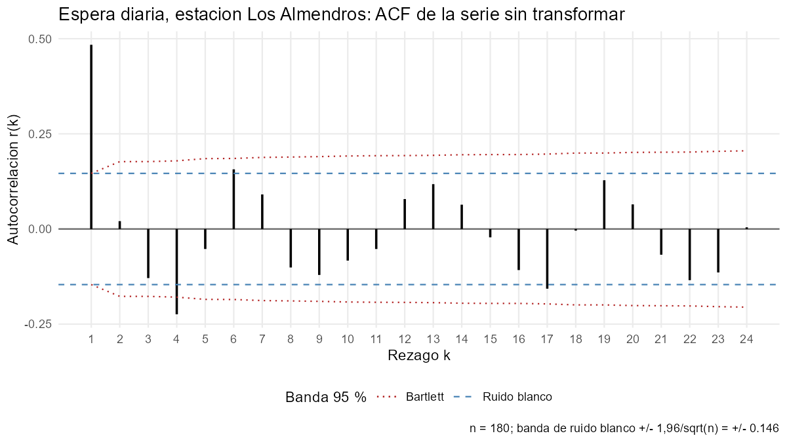{fig-alt="Correlograma de la serie 1 con bandas de ruido blanco y de Bartlett"}

```{r}
#| include: false
r <- res$res3c$serie1$r
b <- 1.96 / sqrt(180)
which(abs(r) > b)     # rezagos fuera de la banda de ruido blanco
round(r[1:8], 2)      # los primeros rezagos
res$resumen3c |> dplyr::filter(serie == "serie1")
```

**Lectura del correlograma.** La serie 1 es de nivel estable. Con $m=24$ rezagos, la autocorrelación del primer rezago es $r_1=`r fmt(s1c$r1, 2)`$, fuera de la banda de ruido blanco ($\pm `r fmt(s1c$banda_rb, 3)`$), y después cae rápidamente: la ACF no decae despacio, como ocurriría con una tendencia, y no repite ondas, como ocurriría con una estacionalidad. Quedan fuera de la banda los rezagos [lista], entre ellos $k=4$ ($r_4=-0{,}22$), con valores pequeños. En el rezago semanal $r_7=`r fmt(s1c$r_s, 2)`$ queda dentro de la banda, lo que concuerda con lo encontrado en 3(b).

**Clasificación del patrón.** La serie es de tipo I: nivel estable, sin tendencia ni estacionalidad, con dependencia solo de corto plazo.


### Serie 2: pasajeros del aeropuerto

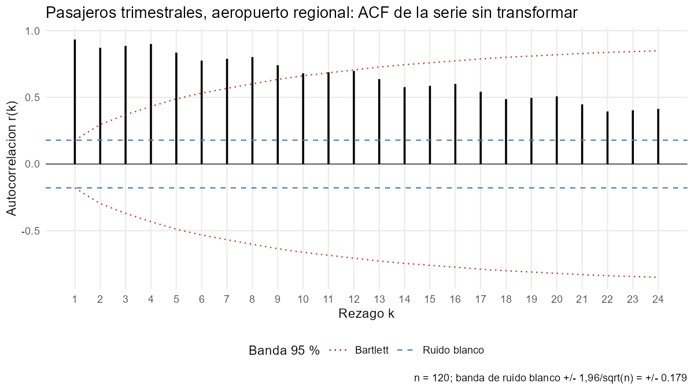{fig-alt="Correlograma de la serie 2 con bandas de ruido blanco y de Bartlett"}

```{r}
#| include: false
r <- res$res3c$serie2$r
round(r[c(2,3,4,5,6,7,8,9,10,11,12,13)], 2)
which(abs(r) > 1.96 / sqrt(120))   # rezagos fuera de la banda de ruido blanco
res$resumen3c |> dplyr::filter(serie == "serie2")
```

**Lectura del correlograma.** La serie 2 tiene tendencia: la ACF decae muy lentamente, con $r_1=`r fmt(s2c$r1, 2)`$ y todavía $r_{24}=0{,}41$, y [N] de los 24 rezagos quedan fuera de la banda de ruido blanco ($\pm `r fmt(s2c$banda_rb, 3)`$). Además, la ACF presenta pequeños picos en los múltiplos de 4: $r_4=0{,}90$ supera a $r_2=0{,}87$ y $r_3=0{,}89$; $r_8=0{,}80$ supera a $r_6=0{,}78$ y $r_7=0{,}79$; y $r_{12}=0{,}70$ supera a $r_{10}=0{,}69$ y $r_{11}=0{,}69$. Estos picos indican una estacionalidad de período $s=4$ (trimestral) superpuesta a la tendencia.

**Clasificación del patrón.** La serie es de tipo IV: con tendencia y estacionalidad.

### Serie 3: viajes de la plataforma

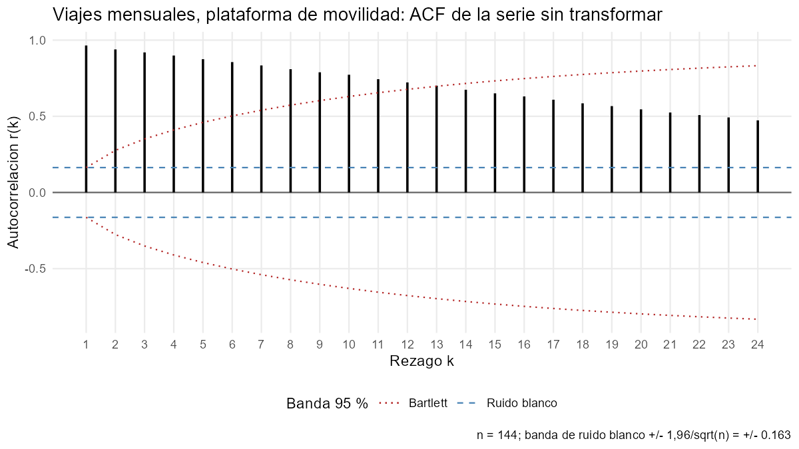{fig-alt="Correlograma de la serie 3 con bandas de ruido blanco y de Bartlett"}

```{r}
#| include: false
r <- res$res3c$serie3$r
round(r[10:14], 2)                 # vecinos de k = 12
sum(abs(r) > 1.96 / sqrt(144))     # cuántos rezagos quedan fuera de la banda (de 24)
res$resumen3c |> dplyr::filter(serie == "serie3")
```
**Lectura del correlograma.** La serie 3 tiene tendencia: la ACF decae lentamente y de forma suave, desde $r_1=`r fmt(s3c$r1, 2)`$ hasta $r_{24}=0{,}47$, y [N] de los 24 rezagos quedan fuera de la banda de ruido blanco ($\pm `r fmt(s3c$banda_rb, 3)`$). No se observan picos en múltiplos de 12: $r_{12}=0{,}72$ queda entre $r_{11}=0{,}74$ y $r_{13}=0{,}70$, siguiendo la línea de decaimiento. Por tanto el correlograma no muestra estacionalidad, lo que concuerda con la decisión de 3(b).

**Clasificación del patrón.** La serie es de tipo III: con tendencia y sin estacionalidad.

:::


# Operador de rezago

## Funciones y verificación

`diferenciar(y, d, D, s)` aplica $(1-B)^d(1-B^s)^D$ restando valores desplazados, sin usar `diff()`, y `polinomio_rezago(coef)` devuelve las raíces de $c(B)=1+c_1B+\cdots+c_pB^p$ con su módulo, usando `polyroot()`.

```{r}
#| echo: false
tibble::tibble(
  Comparacion = c("(1-B)", "(1-B)^2", "(1-B^12)", "(1-B)(1-B^12)"),
  `Maxima diferencia con diff()` = unname(res$verificacion$diferenciar)
) |>
  knitr::kable(digits = 2, format.args = list(scientific = TRUE, decimal.mark = ","))
```

Las diferencias son cero (o del orden de $10^{-15}$), de modo que `diferenciar()` reproduce a `diff()`. Para `polinomio_rezago()`, el polinomio $1-B^{12}$ tiene `r res$verif_polinomio$n_raices_s12` raíces, todas con módulo 1 (error máximo `r format(res$verif_polinomio$modulos_s12, digits = 2)`), y el polinomio $1-0{,}6B$ tiene la raíz $1/0{,}6$, como debe ser.

## Transformaciones candidatas, polinomios y raíces


```{r}
#| include: false
# Auxiliares de 4(b): arman tablas desde res$cand_4b y res$raices_4b
esc2 <- res$cand_4b$escala[res$cand_4b$serie == "serie2"][1]   # "log" o "ninguna"

tabla_candidatas_4b <- function(id) {
  res$cand_4b |>
    dplyr::filter(serie == id) |>
    dplyr::transmute(
      `Escala previa`    = ifelse(escala == "log", "$\\log Y_t$", "ninguna"),
      Operador           = paste0("$", operador, "$"),
      `Polinomio $c(B)$` = paste0("$", polinomio, "$"),
      Grado              = grado
    ) |>
    knitr::kable()
}

tabla_raices_4b <- function(id) {
  res$raices_4b |>
    dplyr::filter(serie == id) |>
    dplyr::transmute(
      Operador = paste0(ifelse(escala == "log", "$\\log$, ", ""), "$", operador, "$"),
      Re = real, Im = imaginaria, Modulo = modulo,
      Periodo = ifelse(is.infinite(periodo), "$\\infty$", format(round(periodo, 2)))
    ) |>
    knitr::kable(digits = 3, format.args = list(decimal.mark = ","))
}
```

Se usan dos propiedades del operador de rezago. El factor $(1-B)^d$ anula cualquier polinomio de grado menor que $d$ y deja constante una tendencia de grado $d$. El factor $(1-B^s)$ anula cualquier patrón determinista de período $s$, porque $S_t-S_{t-s}=0$; sus raíces son las $s$ raíces de la unidad, $e^{2\pi i k/s}$, de período $s/k$. Todas las raíces de estos factores están sobre el círculo unidad (módulo 1), lo cual es lo que se espera de un operador de diferencia.

::: {.panel-tabset}

#### Serie 1: espera en estación

El diagnóstico de la sección 3 (nivel estable, sin tendencia ni estacionalidad) no exige transformar. La candidata principal es la serie sin transformar, con $c(B)=1$, que no tiene raíces. Como contraste se incluye $(1-B)$, para comprobar más adelante que diferenciar una serie que ya era estacionaria es innecesario.

```{r}
#| echo: false
tabla_candidatas_4b("serie1")
```

```{r}
#| echo: false
tabla_raices_4b("serie1")
```

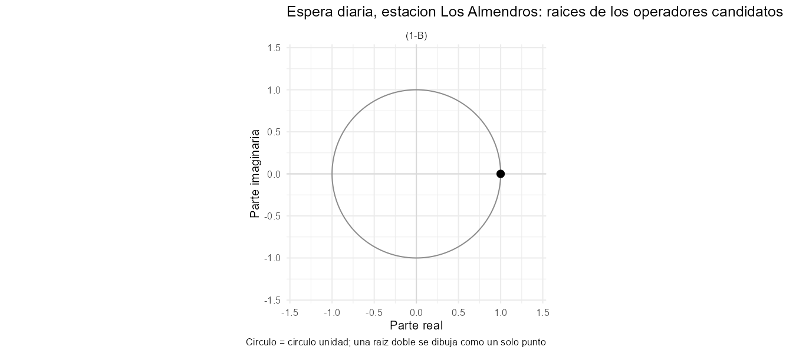{fig-alt="Raíces en el plano complejo de los operadores candidatos de la serie 1"}

**Lectura.** La raíz $B=1$ de $(1-B)$ (módulo 1, período $\infty$) corresponde a un nivel constante: el factor anula la media y, ante una tendencia lineal, la dejaría constante. Como esta serie no tiene tendencia, ese factor solo agregaría una raíz unitaria innecesaria.

#### Serie 2: pasajeros del aeropuerto

La serie tiene tendencia y estacionalidad de período $s=4$. Las candidatas son $(1-B)$ para la tendencia, $(1-B^{4})$ para la estacionalidad y el producto $(1-B)(1-B^{4})$ para ambas`r if (esc2 == "log") ", todas aplicadas sobre $\\log Y_t$, que convierte $Y_t=T_tS_t\\varepsilon_t$ en una suma" else ""`.

```{r}
#| echo: false
tabla_candidatas_4b("serie2")
```

```{r}
#| echo: false
tabla_raices_4b("serie2")
```

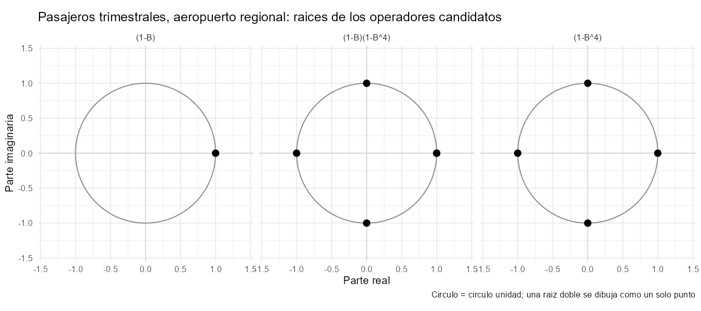{fig-alt="Raíces en el plano complejo de los operadores candidatos de la serie 2"}

**Lectura.** Las raíces de $(1-B)$ y $(1-B^{4})$ son:

- $B=1$ (período $\infty$): elimina el nivel constante y, ante una tendencia lineal, la deja constante.
- $B=\pm i$ (período 4): elimina el ciclo anual de cuatro trimestres.
- $B=-1$ (período 2): elimina el ciclo semestral.

El producto $(1-B)(1-B^{4})=1-B-B^{4}+B^{5}$ tiene la raíz $B=1$ doble, porque el factor $(1-B)$ aparece dos veces; por eso elimina una tendencia lineal además del patrón estacional.

#### Serie 3: viajes de la plataforma

La serie tiene tendencia curva, sin estacionalidad, y una variabilidad que crece con el nivel (los cambios de un mes a otro son pequeños al inicio y grandes al final). La transformación previa de escala es $\log Y_t$, que no es un polinomio en $B$: estabiliza la variabilidad y vuelve aproximadamente lineal una tendencia que crece a tasa constante. Sobre $Y_t$ y sobre $\log Y_t$ se evalúan $(1-B)$ y $(1-B)^2$; los polinomios y las raíces son los mismos en las dos escalas.

```{r}
#| echo: false
tabla_candidatas_4b("serie3")
```

```{r}
#| echo: false
tabla_raices_4b("serie3")
```

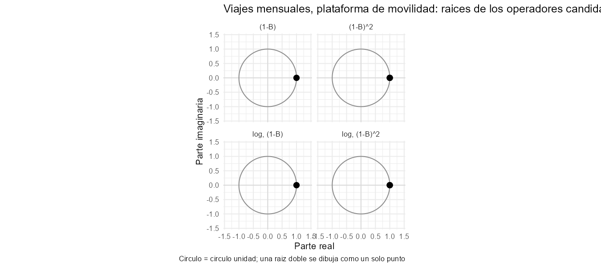{fig-alt="Raíces en el plano complejo de los operadores candidatos de la serie 3"}

**Lectura.** $(1-B)$ tiene la raíz $B=1$ y elimina una tendencia constante. $(1-B)^2=1-2B+B^{2}$ tiene la raíz $B=1$ doble y elimina una tendencia lineal, dejando constante una cuadrática. La serie 3 no lleva factor estacional porque no se le atribuyó estacionalidad en 3(b), así que ninguna candidata incluye $(1-B^{12})$.

:::

## Elección de la transformación y defensa de que no se diferencia de más

Para cada serie se compara la serie original con cada candidata de 4.2 mediante la varianza muestral y la autocorrelación de primer orden $r_1$. La razón de varianzas se calcula dentro de la misma escala, porque la varianza de $\log Y_t$ no es comparable con la de $Y_t$.

**Criterio.** Para un proceso estacionario con autocorrelación $\rho_1$,

$$
\operatorname{Var}(\nabla Y_t)=\operatorname{Var}(Y_t)+\operatorname{Var}(Y_{t-1})-2\operatorname{Cov}(Y_t,Y_{t-1})=2\gamma(0)-2\gamma(1)=2\gamma(0)(1-\rho_1).
$$

Si la serie ya era estacionaria, diferenciar multiplica la varianza por $2(1-\rho_1)$, que es 2 cuando $\rho_1=0$, y empuja $r_1$ hacia $-0{,}5$ (para ruido blanco, $\rho_1(\nabla Y)=-1/2$). En cambio, si la serie tiene tendencia o raíz unitaria, diferenciar reduce la varianza de forma drástica. Por eso se elige la candidata que más reduce la varianza sin que un factor adicional la vuelva a subir: todo factor que suba la varianza y empuje $r_1$ hacia $-0{,}5$ o más allá es una diferencia de más. Un $r_1$ negativo tras diferenciar es una alerta que se discute caso por caso, porque una tendencia determinista más ruido blanco también deja $\rho_1=-1/2$ al diferenciarla: si $Y_t=\beta_0+\beta_1t+\varepsilon_t$, entonces $\nabla Y_t=\beta_1+\varepsilon_t-\varepsilon_{t-1}$. La identidad vale con las estimaciones muestrales solo si la serie es estacionaria.

```{r}
#| label: ayudas-4c
etiqueta_cand <- function(x) ifelse(x == "1", "sin diferenciar",
                             ifelse(x == "log, 1", "log, sin diferenciar", x))

tabla_4c_serie <- function(id) {
  res$tabla_4c |> filter(serie == id) |>
    transmute(Candidata = etiqueta_cand(candidata), n, Media = media,
              `Media esperada` = media_esperada, Varianza = varianza,
              `Var / Var sin dif.` = razon_var, `r(1)` = r1) |>
    knitr::kable(digits = 4, format.args = list(decimal.mark = ",", big.mark = "."))
}

identidad_4c_serie <- function(id) {
  res$identidad_4c |> filter(serie == id) |>
    transmute(Escala = escala, `γ(0)` = gamma0, `γ(1)` = gamma1, `Var(∇Y)` = lado_izq,
              `2γ(0) − 2γ(1)` = lado_der, `Diferencia relativa` = dif_relativa) |>
    knitr::kable(digits = 4, format.args = list(decimal.mark = ",", big.mark = "."))
}

media_4c_serie <- function(id) {
  e <- res$elegida_4c[[id]]
  op <- res$tabla_4c |> filter(serie == id, escala == e$escala, d == e$d, D == e$D) |> pull(candidata)
  res$media_elegida |> filter(serie == id) |>
    transmute(Operador = etiqueta_cand(op), n, Media = media, `Media esperada` = media_esperada,
              `Error estándar ingenuo` = sqrt(varianza / n),
              `Diferencia / error` = (media - media_esperada) / sqrt(varianza / n)) |>
    knitr::kable(digits = 4, format.args = list(decimal.mark = ","))
}
```

::: {.panel-tabset}

### Serie 1: espera en estación

```{r}
#| label: tbl-4c-s1
#| tbl-cap: "Serie 1: varianza muestral y r(1) de la serie y de sus candidatas."
tabla_4c_serie("serie1")
```

```{r}
#| label: tbl-id-s1
#| tbl-cap: "Serie 1: identidad Var(∇Y) = 2γ(0) − 2γ(1)."
identidad_4c_serie("serie1")
```

```{r}
#| label: tbl-media-s1
#| tbl-cap: "Serie 1: media de la serie elegida frente a la que debe dejar el operador."
media_4c_serie("serie1")
```

**Elección: ninguna transformación.** Diferenciar no reduce la varianza, la sube un 3,4 % (de 323,6 a 334,7 s²), y eso es lo que predice la identidad: $2(1-r_1)=2(1-0{,}484)=1{,}03$. La identidad, calculada con el divisor $n$ de la ACF, da 332,8 contra 332,1, una diferencia de apenas 0,2 % (la varianza de 334,7 de la tabla usa el divisor $n-1$); se cumple, lo cual es compatible con una serie estacionaria. La pendiente de la recta ajustada es 0,015 s por día, unos 2,7 s en todo el período frente a una desviación estándar de 18 s, así que no hay tendencia. Además, diferenciar introduce autocorrelación artificial: la serie diferenciada tiene $r_2=-0{,}30$ y $r_4=-0{,}25$, fuera de la banda $\pm$ `r fmt(1.96 / sqrt(nrow(res$datos_series$serie1) - 1), 3)`. Como no se diferencia, la media de la serie es su nivel: 298,8 s, por debajo de la meta contractual de 330 s.

### Serie 2: pasajeros del aeropuerto

```{r}
#| label: tbl-4c-s2
#| tbl-cap: "Serie 2: varianza muestral y r(1) de la serie y de sus candidatas."
tabla_4c_serie("serie2")
```

```{r}
#| label: tbl-id-s2
#| tbl-cap: "Serie 2: identidad Var(∇Y) = 2γ(0) − 2γ(1)."
identidad_4c_serie("serie2")
```

```{r}
#| label: tbl-media-s2
#| tbl-cap: "Serie 2: media de la serie elegida frente a la que debe dejar el operador."
media_4c_serie("serie2")
```

**Elección: $(1-B)(1-B^4)$.** La varianza cae de 305.557 a 26.326 con $(1-B)$, a 5.065 con $(1-B^4)$ y a 4.183 con $(1-B)(1-B^4)$, la mínima de las cuatro. Con el producto, $r_1=-0{,}057$, lejos de $-0{,}5$, así que no hay señal de sobrediferenciación. La diferencia estacional sola no basta: deja $r_1=0{,}58$ y media 60,4, casi cuatro veces la pendiente de la tendencia ($4\times 15{,}5=62{,}1$), es decir, todavía queda tendencia lineal, y por eso hace falta el factor $(1-B)$. La media final es 0,56 en miles de pasajeros (unos 560 pasajeros), a 0,09 errores estándar del 0 que debe dejar el operador. La identidad falla (54 % de diferencia), como corresponde a una serie con tendencia, que no es estacionaria.

### Serie 3: viajes de la plataforma

```{r}
#| label: tbl-4c-s3
#| tbl-cap: "Serie 3: varianza muestral y r(1) de la serie y de sus candidatas."
tabla_4c_serie("serie3")
```

```{r}
#| label: tbl-id-s3
#| tbl-cap: "Serie 3: identidad Var(∇Y) = 2γ(0) − 2γ(1)."
identidad_4c_serie("serie3")
```

```{r}
#| label: tbl-media-s3
#| tbl-cap: "Serie 3: media de la serie elegida frente a la que debe dejar el operador."
media_4c_serie("serie3")
```

**Elección: $\log Y_t$ y $(1-B)$.** La escala logarítmica se justifica con la varianza de los cambios: la de $\nabla Y_t$ pasa de 40,6 en la primera mitad de la serie a 292,2 en la segunda (siete veces más), mientras que la de $\nabla\log Y_t$ se mantiene en 0,00266 y 0,00274. Con $\nabla\log Y_t$ la varianza baja de 0,255 a 0,00269 (razón 0,011). Agregar un segundo factor es una diferencia de más: con $(1-B)^2$ la varianza se multiplica por 2,9 (de 0,00269 a 0,00767) y $r_1$ baja a $-0{,}60$, todavía más negativo que con un solo factor. La media de $\nabla\log Y_t$ es 0,0124, casi igual a la pendiente de la recta ajustada al logaritmo (0,0121); equivale a un crecimiento de 1,24 % mensual, unos 16 % anual. Una cautela sobre $r_1=-0{,}42$, que con $(1-B)$ no queda lejos de $-0{,}5$. Es también lo que deja una tendencia determinista con ruido blanco, porque entonces $\nabla\log Y_t=\beta_1+\varepsilon_t-\varepsilon_{t-1}$ tiene $\rho_1=-1/2$; así, parte de la tendencia podría ser determinista y no estocástica. Aun así $(1-B)$ es la candidata menos mala: $\log Y_t$ sin diferenciar tiene tendencia y no es estacionaria en media, y $(1-B)^2$ empeora ($r_1=-0{,}60$ y varianza multiplicada por 2,9). Esto se revisa en la sección 5 con la ACF y la PACF de la serie transformada y en 6(b) con la regresión sobre una tendencia. La identidad falla (diferencia relativa de 4,1, es decir, 410 %), como en cualquier serie con tendencia.

:::

**Qué le pasa a $r_1$ al diferenciar una serie estacionaria.** Con 500 valores de ruido blanco simulado, el único caso en que se conoce la respuesta, se obtiene lo que predice la teoría.

```{r}
#| label: tbl-sobre
#| tbl-cap: "Efecto de diferenciar un ruido blanco simulado (n = 500)."
res$sobrediferencia |>
  transmute(`r(1) del ruido` = r1_ruido, `r(1) de la diferencia` = r1_difer,
            `Var(dif) / Var(ruido)` = razon_var) |>
  knitr::kable(digits = 3, format.args = list(decimal.mark = ","))
```

**Transformaciones elegidas.** El error estándar de las tablas de media es el ingenuo, a modo de verificación preliminar; el adecuado, con la varianza de largo plazo, se construye en 5(c).

| Serie | Transformación | Escrita en $B$ | Plausiblemente estacionaria |
|---|---|---|---|
| 1 | ninguna | $1$ | sí; la identidad se cumple al 0,2 % |
| 2 | $(1-B)(1-B^4)$ | $1-B-B^4+B^5$ | sí; $r_1=-0{,}057$, media 0,56 |
| 3 | $\log$ y $(1-B)$ | $1-B$ | con la cautela de $r_1=-0{,}42$ |

## Las funciones de pronóstico de Holt y Holt–Winters como soluciones de ecuaciones en diferencias

**Convención.** Desde el origen $T$, los pronósticos son una función del horizonte $h=1,2,\dots$: $f(h)=\hat Y_{T+h}$. Los números $L_T$, $\hat T_T$ y $S_{T-s+1},\dots,S_T$ ya están calculados en $T$ y no dependen de $h$. Aquí el operador de rezago actúa sobre $h$, no sobre el tiempo: $Bf(h)=f(h-1)$. Esa expresión solo es un pronóstico si $h-1\ge 1$, porque $f(0)=\hat Y_T$ no lo es. De ahí salen los rangos de $h$ que pide el enunciado.

::: {.panel-tabset}

### Holt

**Afirmación.** $f(h)=L_T+\hat T_T\,h$ satisface $(1-B)^2f(h)=0$ para $h\ge 3$.

**Prueba.** Sean $a=L_T$ y $b=\hat T_T$, de modo que $f(h)=a+bh$.

1. Para $h\ge 2$ (así $h-1\ge 1$ y $f(h-1)$ es un pronóstico):

   $$(1-B)f(h)=f(h)-f(h-1)=(a+bh)-\big(a+b(h-1)\big)=b,$$

   una constante que no depende de $h$.

2. Sea $g(h)=(1-B)f(h)=b$ para $h\ge 2$. Para aplicar $(1-B)$ otra vez se necesitan $g(h)$ y $g(h-1)$, y ambos requieren índice $\ge 2$, es decir, $h\ge 3$:

   $$(1-B)^2f(h)=g(h)-g(h-1)=b-b=0.$$

Equivalentemente,

$$f(h)-2f(h-1)+f(h-2)=a(1-2+1)+b\big(h-2(h-1)+(h-2)\big)=0 .$$

Se pide $h\ge 3$ porque el término $f(h-2)$ es un pronóstico solo si $h-2\ge 1$. $\blacksquare$

**Solución general.** El polinomio característico es $c(z)=(1-z)^2$, con la raíz $z=1$ de multiplicidad $m=2$, así que $R=z^{-1}=1$. Con la fórmula de las clases 7 y 8, $Z_h=\sum_i\sum_{j=0}^{m_i-1}b_{ij}\,h^jR_i^h$, queda

$$f(h)=(b_0+b_1h)\cdot 1^h=b_0+b_1h .$$

Toda solución es una recta. Holt elige la recta con $b_0=L_T$ y $b_1=\hat T_T$.

**Qué raíces corresponden a qué.** La raíz $z=1$ (módulo 1, período $\infty$) es la única, y es doble. La primera copia aporta el nivel $b_0$ (una constante). La segunda copia, por ser raíz repetida, multiplica por $h$ y aporta la pendiente $b_1h$. Todas las raíces corresponden a la tendencia; no hay raíces de estacionalidad.

### Holt–Winters aditivo

**Afirmación.** $f(h)=L_T+\hat T_T\,h+\psi(h)$, con $\psi(h)=S_{T+h-s\lceil h/s\rceil}$, satisface $(1-B)(1-B^s)f(h)=0$ para $h\ge s+2$.

**Prueba.** Sean $a=L_T$ y $b=\hat T_T$.

1. **El componente estacional es periódico de período $s$.** Para $h\ge 1$, $\lceil (h+s)/s\rceil=\lceil h/s\rceil+1$, luego

   $$(h+s)-s\left\lceil \tfrac{h+s}{s}\right\rceil=h+s-s\left\lceil \tfrac hs\right\rceil-s=h-s\left\lceil \tfrac hs\right\rceil,$$

   es decir, $\psi(h+s)=\psi(h)$. Para $h=1,\dots,s$ se tiene $\lceil h/s\rceil=1$ y $\psi(h)=S_{T+h-s}$, que recorre los últimos $s$ índices estacionales $S_{T-s+1},\dots,S_T$; desde allí se repiten. Por tanto $(1-B^s)\psi(h)=\psi(h)-\psi(h-s)=0$ para $h-s\ge 1$, es decir, $h\ge s+1$.

2. **El factor $(1-B^s)$ sobre la recta.** Para $h\ge s+1$:

   $$(1-B^s)(a+bh)=(a+bh)-\big(a+b(h-s)\big)=bs,$$

   una constante.

3. **Se juntan los dos pasos.** Para $h\ge s+1$,

   $$g(h):=(1-B^s)f(h)=bs+0=bs .$$

4. **El factor $(1-B)$.** Para aplicarlo se necesitan $g(h)$ y $g(h-1)$, y ambos requieren índice $\ge s+1$, es decir, $h-1\ge s+1$, o sea $h\ge s+2$:

   $$(1-B)(1-B^s)f(h)=g(h)-g(h-1)=bs-bs=0 .$$

Como $(1-B)$ y $(1-B^s)$ conmutan, el orden en que se aplican no importa. En $h=s+1$ la expresión usaría $f(0)$, que no es un pronóstico; por eso el rango es $h\ge s+2$. $\blacksquare$

**Solución general.** El polinomio característico se factoriza como

$$c(z)=(1-z)(1-z^s)=(1-z)^2\,(1+z+\cdots+z^{s-1}).$$

Sus raíces son:

- $z=1$, doble;
- $z_k=e^{2\pi i k/s}$, $k=1,\dots,s-1$, todas simples y de módulo 1, de período $s/k$.

Las inversas son $R_k=e^{-2\pi i k/s}$. La solución general es entonces

$$f(h)=\underbrace{b_0+b_1h}_{z=1\text{ doble}}+\underbrace{\sum_{k=1}^{s-1}c_k\,e^{-2\pi i kh/s}}_{\text{raíces } z_k}.$$

Como $f$ es real, las raíces se agrupan en pares conjugados $z_k,z_{s-k}$, cada uno con un término $e_{1k}\cos(2\pi kh/s)+e_{2k}\sin(2\pi kh/s)$; si $s$ es par, $k=s/2$ ($z=-1$) aporta $e\,(-1)^h$. Para $s=4$, el caso de la serie 2:

$$f(h)=b_0+b_1h+e_1\cos\!\left(\tfrac{\pi h}{2}\right)+e_2\sin\!\left(\tfrac{\pi h}{2}\right)+e_3(-1)^h .$$

**Qué raíces corresponden a qué.**

| Raíz de $c(z)=0$ | Módulo | Período | Componente |
|---|---|---|---|
| $z=1$, primera copia | 1 | $\infty$ | nivel $b_0$ |
| $z=1$, segunda copia (doble) | 1 | $\infty$ | tendencia lineal $b_1h$ |
| $z_k=e^{2\pi i k/s}$, $k=1,\dots,s-1$ | 1 | $s/k$ | estacionalidad: $s-1$ armónicos |

La solución tiene $s+1$ constantes libres, aunque el método carga $L_T$, $\hat T_T$ y $s$ índices estacionales ($s+2$ números). La diferencia se debe a que el nivel y el promedio de los índices estacionales no se pueden separar en la función de pronóstico: ambos viven en la raíz $z=1$, y $b_0=L_T+\frac1s\sum_{j=0}^{s-1}S_{T-j}$.

### Comprobación numérica

Con valores arbitrarios que no provienen de las series:

```{r}
local({
  H <- 20; h <- 1:H
  a <- 5; b <- 0.7                          # L_T y T_T arbitrarios
  s <- 4; S <- c(2, -1, 0.5, -1.5)          # S_{T-s+1}, ..., S_T arbitrarios
  pos  <- h - s * ceiling(h / s) + s        # posicion de S_{T+h-s*ceiling(h/s)} dentro de S
  holt <- a + b * h
  hw   <- a + b * h + S[pos]
  d2  <- holt[3:H] - 2 * holt[2:(H - 1)] + holt[1:(H - 2)]   # (1-B)^2, h = 3, ..., H
  g   <- hw[(s + 1):H] - hw[1:(H - s)]                       # (1-B^s), h = s+1, ..., H
  d1s <- g[-1] - g[-length(g)]                               # (1-B)(1-B^s), h = s+2, ..., H
  c(Holt = max(abs(d2)), `Holt-Winters` = max(abs(d1s)))
})
```

Las dos cantidades son del orden de $10^{-15}$, es decir, cero salvo error de redondeo, y los rangos de $h$ de los vectores `d2` y `d1s` son exactamente $h\ge 3$ y $h\ge s+2$.

:::

**Conexión con 4.2.** Los factores $(1-B)$ y $(1-B^s)$ de las candidatas de 4.2 son exactamente los que anulan estas funciones de pronóstico: $(1-B)^2$ anula la recta de Holt, y $(1-B)(1-B^s)$ anula la recta más el patrón estacional de Holt–Winters. Para $s=4$, las raíces $1$ (doble), $\pm i$ y $-1$ son las mismas de la tabla de la serie 2.


# Dependencia y estacionariedad

El trabajo de esta sección se hace, para cada serie, sobre la serie resultante de la transformación elegida en la sección 4: la serie 1 sin transformar, la serie 2 con $(1-B)(1-B^4)$ y la serie 3 con $\log$ y $(1-B)$.

```{r}
#| label: ayudas-5
#| include: false

fig_md <- function(archivo, pie) cat("\n\n", sep = "")
tabla_md <- function(df, ...) { cat(knitr::kable(df, format = "pipe", ...), sep = "\n"); cat("\n\n") }

b5a <- function(id) {
  z <- res$resumen5 |> dplyr::filter(serie == id)
  fig_md(paste0(id, "-acf-pacf.png"), "ACF (izquierda) y PACF (derecha) de la serie transformada.")
  tabla_md(data.frame(
    `Gráfico` = c("ACF", "ACF", "PACF"),
    Banda = c("Ruido blanco", "Bartlett", "Ruido blanco"),
    `Rezagos fuera de la banda` = c(z$acf_fuera_rb, z$acf_fuera_bartlett, z$pacf_fuera_rb),
    check.names = FALSE))
}

b5b <- function(id) {
  zz <- res$res5[[id]]
  cat("**Prueba de Ljung–Box** con $m=", zz$m_lb, "$ rezagos y ", zz$m_lb,
      " grados de libertad (no se restan parámetros: la serie transformada no viene de un modelo ajustado).\n\n", sep = "")
  tabla_md(prueba_a_tabla(zz$lb))
  cat("**Sensibilidad al valor de $m$.**\n\n")
  tabla_md(zz$sensibilidad |>
             dplyr::transmute(m = m, Q = Q, `g.l.` = gl, `Valor crítico` = critico,
                              `Valor p` = format.pval(p, digits = 3)),
           digits = 3)
}

b5c <- function(id) {
  zz <- res$res5[[id]]
  cat("**Media y varianza por bloque.**\n\n")
  tabla_md(zz$bloques |>
             dplyr::transmute(Bloque = bloque, n = n, Desde = format(desde), Hasta = format(hasta),
                              Media = media, Varianza = varianza, `Desv. estándar` = desv),
           digits = 4)
  fig_md(paste0(id, "-bloques.png"), "Serie transformada y media de cada bloque.")
  cat("**Media con dos errores estándar** (media = ", fmt(zz$media, 4), "; $L=", zz$L, "$).\n\n", sep = "")
  tabla_md(data.frame(
    `Error estándar` = c("Ingenuo, $\\hat\\sigma/\\sqrt{n}$", "Largo plazo, núcleo de Bartlett"),
    Valor = c(zz$se_ing, zz$se_lp),
    `IC 95 % inferior` = c(zz$ic_ing[1], zz$ic_lp[1]),
    `IC 95 % superior` = c(zz$ic_ing[2], zz$ic_lp[2]),
    check.names = FALSE), digits = 4)
  cat("Razón de errores estándar (largo plazo / ingenuo): ", fmt(zz$se_lp / zz$se_ing, 2), ".\n\n", sep = "")
}
```

## ACF y PACF muestrales

La autocorrelación parcial se calcula con `pacf_dl()`, la recursión de Durbin y Levinson a partir de $r_1,\dots,r_m$. Se verificó contra `pacf()` de R con una máxima diferencia absoluta de `r format(res$verificacion$pacf_dl, digits = 2)`, menor que $10^{-10}$.

Cada gráfico lleva la banda de ruido blanco, $\pm 1{,}96/\sqrt{n}$, y en la ACF también la banda secuencial de Bartlett, $\pm 1{,}96\sqrt{\left(1+2\sum_{i<h}r_i^2\right)/n}$. Se usan $m=\min\{\lfloor n/4\rfloor,\,24\}$ rezagos, con $n$ el número de observaciones de la serie transformada.

::: {.panel-tabset}

### Serie 1: espera en estación

```{r}
#| output: asis
b5a("serie1")
```

**Lectura de la ACF y la PACF.** *Pendiente.*

**Qué pregunta responde cada banda.** *Pendiente.*

<!-- Preguntas: ¿cómo es la forma de la ACF (cae de golpe, decae poco a poco, oscila)? ¿y la de la PACF?
     ¿cuántos rezagos salen de cada banda? La banda de ruido blanco, ¿para qué pregunta sirve: para
     decidir si UN rezago aislado es significativo en una serie sin autocorrelación, o si el rezago h
     aporta autocorrelación nueva dado que los anteriores ya son significativos? ¿y la de Bartlett? -->

### Serie 2: pasajeros del aeropuerto

```{r}
#| output: asis
b5a("serie2")
```

**Lectura de la ACF y la PACF.** *Pendiente.*

**Qué pregunta responde cada banda.** *Pendiente.*

<!-- Preguntas: igual que en la serie 1. Además: ¿qué hay en los rezagos 4 y 8 (múltiplos de s = 4)?
     ¿la transformación quitó la estacionalidad o queda algo? -->

### Serie 3: viajes de la plataforma

```{r}
#| output: asis
b5a("serie3")
```

**Lectura de la ACF y la PACF.** *Pendiente.*

**Qué pregunta responde cada banda.** *Pendiente.*

<!-- Preguntas: igual que en la serie 1. Además: ¿qué forma tienen la ACF y la PACF y qué dice eso de
     r1 = -0,42 que viste en la sección 4? ¿hay algo en el rezago 12? -->

:::

## Prueba de Ljung–Box y procesos compatibles

La prueba de Ljung–Box contrasta que las primeras $m$ autocorrelaciones son nulas,

$$Q_m=n(n+2)\sum_{k=1}^{m}\frac{r_k^2}{n-k}\;\sim\;\chi^2_{m}\quad\text{bajo }H_0,$$

con $m$ grados de libertad porque no hay parámetros estimados. Para decidir con qué proceso es compatible la forma de la ACF y la PACF se usan las firmas teóricas de las clases 3 y 8.

| Proceso | ACF | PACF |
|---|---|---|
| Ruido blanco | cero en todos los rezagos | cero en todos los rezagos |
| AR($p$) | decae (exponencial o sinusoidal amortiguada) | se corta después del rezago $p$ |
| MA($q$) | se corta después del rezago $q$ | decae |
| ARMA($p,q$) | decae | decae |
| Raíz unitaria (paseo aleatorio) | decae muy lentamente, cerca de 1 | $\phi_{11}\approx 1$ y el resto cerca de 0 |

::: {.panel-tabset}

### Serie 1: espera en estación

```{r}
#| output: asis
b5b("serie1")
```

**Elección y justificación de $m$.** *Pendiente.*

**Procesos compatibles y no compatibles.** *Pendiente.*

<!-- Preguntas: ¿por qué ese m y no otro (mira la tabla de sensibilidad: ¿cambia la decisión)? ¿qué
     proceso de la tabla encaja con la forma de la ACF y la PACF y cuáles no, y por qué? -->

### Serie 2: pasajeros del aeropuerto

```{r}
#| output: asis
b5b("serie2")
```

**Elección y justificación de $m$.** *Pendiente.*

**Procesos compatibles y no compatibles.** *Pendiente.*

### Serie 3: viajes de la plataforma

```{r}
#| output: asis
b5b("serie3")
```

**Elección y justificación de $m$.** *Pendiente.*

**Procesos compatibles y no compatibles.** *Pendiente.*

:::

## Estacionariedad y ergodicidad

Cada serie transformada se divide en cuatro bloques consecutivos de igual tamaño (salvo una observación) y se compara su media y su varianza. La media se estima con dos errores estándar. El ingenuo supone observaciones incorrelacionadas, $\hat\sigma/\sqrt{n}$. El de largo plazo usa la varianza de largo plazo con núcleo de Bartlett,

$$\hat\sigma^2_{LP}=\hat\gamma(0)+2\sum_{k=1}^{L}\left(1-\frac{k}{L+1}\right)\hat\gamma(k),\qquad L=\left\lfloor 4\left(\frac{n}{100}\right)^{2/9}\right\rfloor,$$

y su error estándar es $\hat\sigma_{LP}/\sqrt{n}$.

::: {.panel-tabset}

### Serie 1: espera en estación

```{r}
#| output: asis
b5c("serie1")
```

**Estacionariedad por bloques.** *Pendiente.*

**Los dos errores estándar: por qué difieren y cuál es el adecuado.** *Pendiente.*

**Qué representa la media en términos de la serie original.** *Pendiente.*

<!-- Preguntas: ¿las medias y las varianzas de los cuatro bloques son parecidas o cambian de forma
     sistemática? ¿qué diferencia hay entre los dos errores estándar y a qué se debe (mira el signo de
     las autocorrelaciones del correlograma)? ¿cuál de los dos intervalos es el adecuado y por qué?
     ¿qué es, en la serie original, esa media (un nivel, un crecimiento, un cambio)? -->

### Serie 2: pasajeros del aeropuerto

```{r}
#| output: asis
b5c("serie2")
```

**Estacionariedad por bloques.** *Pendiente.*

**Los dos errores estándar: por qué difieren y cuál es el adecuado.** *Pendiente.*

**Qué representa la media en términos de la serie original.** *Pendiente.*

### Serie 3: viajes de la plataforma

```{r}
#| output: asis
b5c("serie3")
```

**Estacionariedad por bloques.** *Pendiente.*

**Los dos errores estándar: por qué difieren y cuál es el adecuado.** *Pendiente.*

**Qué representa la media en términos de la serie original.** *Pendiente.*

:::


# Pronóstico y evaluación

*Pendiente.*

# Conclusión técnica

*Pendiente.*

# Argumentos para los interesados

*Pendiente.*

# README, reproducibilidad y uso de Git

*Pendiente.*
